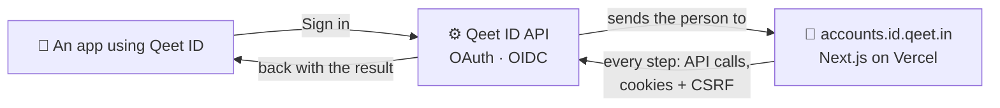

<div align="center">

# 🔐 Qeet ID hosted pages

**The pages Qeet ID sends people to when an app asks them to sign in: sign-in with passkeys, sign-up, consent,
recovery and device sign-in, at [accounts.id.qeet.in](https://accounts.id.qeet.in).**

[](https://nextjs.org)
[](https://react.dev)
[](https://ui.qeet.in)
[](https://www.typescriptlang.org)
[](https://bun.sh)
[](https://accounts.id.qeet.in)

[🏗️ Architecture](#️-architecture) · [🚀 Run it](#-run-it-locally) · [⚙️ Configuration](#️-configuration)

</div>

## 🏗️ Architecture

A thin Next.js front end on Vercel. It holds no database, no tokens and no secrets: every step calls the
Qeet ID API, which owns all sign-in logic and keeps the session in its own HttpOnly cookies.



| Part | Where |
|:--|:--|
| 🔑 **Sign-in** | Passkeys (WebAuthn), password, social, company sign-in (SAML, OpenID Connect, LDAP), magic link, one-time code and two-step verification: `src/modules/authentication` |
| 📝 **Sign-up, consent, devices** | Account creation, the OAuth consent screen and TV / CLI device codes: `src/app/(auth)`, `src/modules/oauth` |
| 🛟 **Recovery and sign-out** | Password reset, magic links, sign-out: `src/modules/recovery`, `src/modules/sign-out` |
| 🏢 **Enterprise setup** | SAML and SCIM setup for an invited IT admin: `src/modules/enterprise-setup` |
| 🗝️ **Account security** | A person's passkeys, to see, rename and add: `src/modules/account` |
| 🛡️ **Security** | A nonce-based Content-Security-Policy on every page, validated redirects only, no token ever stored: `src/platform/security` |
| 🎨 **Design and languages** | Qeetrix (`@qeetrix/react`, `@qeetrix/tokens`, `@qeetrix/icons`), light and dark, on the approved hosted mockups; i18next: `src/i18n` |
| 🩺 **Health** | `GET /healthz` |

## 🚀 Run it locally

Needs [Bun](https://bun.sh) 1.3+ and a running [`qeet-id-server`](https://github.com/qeetgroup/qeet-id-server)
(local default `http://localhost:4001`).

```bash
bun install --frozen-lockfile
cp .env.example .env.local
bun run dev            # http://localhost:3003, the origin the server allows for passkeys
```

| Script | For |
|:--|:--|
| `bun run dev` | Development server on port 3003 |
| `bun run build` | Production build |
| `bun run typecheck` | Types |
| `bun run check` | Lint and format (Biome) |
| `bun run test` | Unit and component tests (Vitest) |
| `bun run test:e2e` | Every page in Chromium: its Content-Security-Policy and a WCAG 2.2 AA scan |
| `bun run contract:sync` | Copy the server's API documents and regenerate the types every call is checked against |
| `bun run contract:check` | The copied documents and generated types are current |
| `bun run sonar` | SonarQube analysis with coverage (local SonarQube from `qeet-id-server`) |

## ⚙️ Configuration

| Variable | What it is |
|:--|:--|
| `NEXT_PUBLIC_API_URL` | The Qeet ID API, for example `http://localhost:4001` (public; built into the pages) |
| `QEET_ID_RELAY_KEY` | Optional. One of the API's relay keys; read on the server only |
| `LOGIN_TRUSTED_PROXY_HOPS` | Optional. How many proxies in front of the app add to `X-Forwarded-For` |

## 🚢 Releasing

Releases are monthly and named after the month they ship.

1. Changes land on `develop`; run the tests, the build and the browser tests locally before pushing (**Verify** in CI
   checks types, formatting, lint and the dependency audit).
2. Each month `release/2027.1.0` (for example) is cut from `develop`: testers check it in TEST and STAGING. A fix they
   need is made on `develop` first, then copied to the release branch.
3. After sign-off, the pull request from the release branch into `main` deploys
   [accounts.id.qeet.in](https://accounts.id.qeet.in) and tags `v2027.1.0`. An urgent fix afterwards is
   `hotfix/2027.1.1`.

## 🧩 Related repositories

| Repository | What it is |
|:--|:--|
| [`qeet-id-server`](https://github.com/qeetgroup/qeet-id-server) | The Qeet ID platform and its API |
| [`qeet-id-console`](https://github.com/qeetgroup/qeet-id-console) | The console where organisations manage Qeet ID |
| [`qeet-id-website`](https://github.com/qeetgroup/qeet-id-website) | The public website, [id.qeet.in](https://id.qeet.in) |
| [`qeet-id-kit`](https://github.com/qeetgroup/qeet-id-kit) | Runs the whole product locally for testers |
